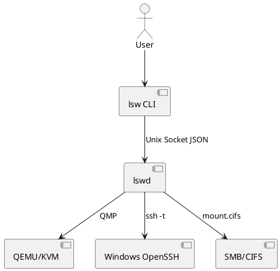

# SKILL.md

本文件定义 LSW 项目的核心技能。AI 代理或开发者执行任务时，按对应技能操作，并同步更新文档。

---

## 路径基准（所有技能统一使用）

```bash
CONFIG="${XDG_CONFIG_HOME:-$HOME/.config}/lsw/config.toml"   # 配置
DATA="${XDG_DATA_HOME:-$HOME/.local/share}/lsw"              # 持久数据
STATE="${XDG_STATE_HOME:-$HOME/.local/state}/lsw"            # 状态与日志
RUNTIME="${XDG_RUNTIME_DIR}/lsw"                             # 套接字与 PID
```

- `$DATA/vm/disk.qcow2`：Windows 系统盘；`$DATA/vm/OVMF_VARS.fd`：UEFI 变量。
- `$RUNTIME/qmp.sock`、`$RUNTIME/qga.sock`、`$RUNTIME/lswd.sock`、`$RUNTIME/lswd.pid`：运行时资源，重启即失效，禁止放进 `$DATA`/`$STATE`。
- Windows SSH 用户名统一取 `config.user.windows_user`（默认 `lsw`）；`PROMPT.md` 示例中的 `user` 即该字段。

---

## SKILL-01：添加或修改 CLI 命令

### 目的

在 `lsw` CLI 中新增、修改命令，并保持与 `lswd` IPC 一致。

### 步骤

1. 修改 `src/cli/main.cpp`。
2. 在 `include/lsw/cli/commands.hpp` 声明命令处理器。
3. 如需要守护进程支持，新增 IPC 请求类型。
4. 更新 `docs/interfaces/cli.md`。
5. 更新 `docs/interfaces/daemon-ipc.md`。
6. 更新 `docs/diagrams/component.puml`。
7. 添加测试。

### 验收

```bash
lsw --help
lsw <command> --help
```

输出与文档一致。

---

## SKILL-02：QEMU 生命周期管理

### 目的

实现 `lsw start`、`lsw shutdown`、`lsw --install` 的 QEMU 管理。

### 关键接口

```cpp
class QemuVm {
public:
  Result<void> create_install_vm(const Config& cfg);
  Result<void> start(const Config& cfg);
  Result<void> shutdown();
  Result<VmStatus> status();
};
```

### QEMU 安装模式示例

```bash
qemu-system-x86_64 \
  -name lsw-windows \
  -enable-kvm -machine q35,accel=kvm -cpu host -smp 4 -m 8192 \
  -drive if=pflash,format=raw,readonly=on,file=/usr/share/OVMF/OVMF_CODE.fd \
  -drive if=pflash,format=raw,file=$DATA/vm/OVMF_VARS.fd \
  -drive file=$DATA/vm/disk.qcow2,if=virtio,format=qcow2 \
  -drive file=$WIN_ISO,media=cdrom,readonly=on \
  -drive file=$VIRTIO_ISO,media=cdrom,readonly=on \
  -netdev user,id=net0,hostfwd=tcp:127.0.0.1:2222-:22,hostfwd=tcp:127.0.0.1:1445-:445,smb=$HOME \
  -device virtio-net-pci,netdev=net0 \
  -qmp unix:$RUNTIME/qmp.sock,server=on,wait=off \
  -chardev socket,path=$RUNTIME/qga.sock,server=on,wait=off,id=qga0 \
  -device virtio-serial \
  -device virtserialport,chardev=qga0,name=org.qemu.guest_agent.0 \
  -display gtk
```

运行模式将 `-display gtk` 改为 `-display none`，由 `lswd` 管理进程。

> 固件策略（P4 实测）：Windows 10 默认使用 SeaBIOS（BIOS）并 `-boot order=d` 优先光驱，兼容性最好；`lsw --install --firmware ovmf` 可切换 OVMF/UEFI，供 Windows 11 等场景使用。

### 文档更新

- `docs/interfaces/qmp.md`
- `docs/diagrams/sequence-install.puml`
- `docs/diagrams/sequence-start.puml`
- `docs/diagrams/sequence-shutdown.puml`

---

## SKILL-03：QMP 交互

### 目的

通过 QMP Socket 控制 QEMU。

Socket：`$RUNTIME/qmp.sock`（`$RUNTIME=${XDG_RUNTIME_DIR}/lsw`）。

### 接口

```cpp
class QmpClient {
public:
  Result<void> connect(const std::filesystem::path& sock);
  Result<json> execute(const std::string& command, const json& args = {});
  Result<void> system_powerdown();
  Result<bool> query_status();
};
```

### QMP 示例

```json
{ "execute": "qmp_capabilities" }
{ "execute": "query-status" }
{ "execute": "system_powerdown" }
```

### 文档更新

- `docs/interfaces/qmp.md`
- `docs/diagrams/sequence-shutdown.puml`

---

## SKILL-04：SSH 交互式 PowerShell 桥接

### 目的

实现 `lsw` / `lsw shell`，直接在当前终端进入 PowerShell。

### 路径映射

```cpp
std::optional<std::string> linux_to_z(const fs::path& cwd, const fs::path& home) {
  auto c = fs::weakly_canonical(cwd);
  auto h = fs::weakly_canonical(home);
  auto rel = c.lexically_relative(h);
  if (rel.empty() || rel.native().starts_with("..")) return std::nullopt;
  if (rel == ".") return std::nullopt; // 默认路径
  std::string win = "Z:";
  for (auto& p : rel) win += "\\" + p.string();
  return win;
}
```

### 执行方式

必须使用 `execvp` 替换当前进程：

```cpp
// $WINDOWS_USER 来自 config.user.windows_user，默认 lsw；端口来自 config.network.ssh_host_port
std::string ssh_target = cfg.user.windows_user + "@127.0.0.1";
std::vector<std::string> args = {
  "ssh", "-t", "-p", std::to_string(cfg.network.ssh_host_port), ssh_target, "--",
  "powershell.exe", "-NoLogo", "-NoExit"
};
if (auto z = linux_to_z(cwd, home)) {
  args.push_back("-Command");
  args.push_back("Set-Location -LiteralPath '" + *z + "'");
}
execvp("ssh", to_argv(args).data());
```

### 验收

- 在 `~/Project/demo` 执行 `lsw`，PowerShell 位于 `Z:\Project\demo`。
- 在 `~` 执行 `lsw`，PowerShell 为默认路径。
- 不新开窗口。
- 退出 PowerShell 后回到原 shell。

### 文档更新

- `docs/interfaces/cli.md`
- `docs/diagrams/sequence-shell.puml`

---

## SKILL-05：Windows 程序执行 `lsw test.exe`

### 目的

在 Windows 环境执行 Linux 侧指定的 exe，不支持 GUI。

### 步骤

1. 解析 exe 路径。
2. 如果不在 `$HOME` 下，复制到 `$HOME/.lsw/tmp/<hash>/`。
3. 映射为 `Z:\...`。
4. SSH 执行：

```bash
# $WINDOWS_USER 来自 config.user.windows_user，默认 lsw
ssh -p 2222 "$WINDOWS_USER"@127.0.0.1 \
  "powershell.exe -NoProfile -Command \"& 'Z:\\path\\test.exe' arg1 arg2; exit \$LASTEXITCODE\""
```

5. 捕获 stdout、stderr、退出码。

### 错误码

- `0`：成功
- `5`：路径映射失败
- `6`：SSH 执行失败
- `7`：程序返回非零

### 文档更新

- `docs/interfaces/cli.md`
- `docs/diagrams/sequence-exec.puml`

---

## SKILL-06：挂载 Windows 盘到 `/mnt/Windows`

### 目的

将 Windows `C$`、`D$` 挂载到 Linux。

### 前提

Windows 内启用 SMB，开放 445 端口。QEMU 端口转发：

```text
hostfwd=tcp:127.0.0.1:1445-:445
```

### Linux 挂载

```bash
sudo mkdir -p /mnt/Windows/C /mnt/Windows/D

sudo mount -t cifs //127.0.0.1/C$ /mnt/Windows/C \
  -o port=1445,username=<user>,password=<pass>,vers=3.0

sudo mount -t cifs //127.0.0.1/D$ /mnt/Windows/D \
  -o port=1445,username=<user>,password=<pass>,vers=3.0
```

### 安全

- 禁止明文保存密码。
- 使用 libsecret/keyring。
- 卸载使用 `umount`。

### 文档更新

- `docs/interfaces/filesystem.md`
- `docs/diagrams/component.puml`

---

## SKILL-07：Windows 映射 `Z:` 到 Linux `$HOME`

### 目的

让 Windows 访问 Linux 家目录，路径与 `lsw shell` 自动 cd 对应。

### 方案

优先 QEMU user SMB：

```bash
-netdev user,id=net0,smb=$HOME
```

Windows 内：

```powershell
net use Z: \\10.0.2.4\qemu /persistent:yes
```

备选：Linux 运行 Samba，Windows 映射：

```powershell
net use Z: \\10.0.2.2\lsw /persistent:yes
```

### 验收

Windows PowerShell：

```powershell
Set-Location Z:\Project\demo
Get-Location
```

应显示 `Z:\Project\demo`。

### 文档更新

- `docs/interfaces/filesystem.md`
- `docs/diagrams/sequence-start.puml`

---

## SKILL-08：文档同步与调用关系图

### 目的

每次任务后生成/更新接口文档和调用关系图。

### 必须更新的文件

- `docs/CHANGELOG.md`
- `docs/interfaces/cli.md`
- `docs/interfaces/daemon-ipc.md`
- `docs/interfaces/qmp.md`
- `docs/interfaces/filesystem.md`
- `docs/interfaces/config.md`
- `docs/diagrams/component.puml`
- 相关 `docs/diagrams/sequence-*.puml`

### 接口文档模板

```markdown
# 接口名称

## 模块
## 职责
## 公开接口
## 输入
## 输出
## 错误码
## 依赖
## 调用关系
## 变更记录
```

### PlantUML 组件图模板



### 规则

- 代码变更导致框架调整时，必须同步修改接口文档和调用关系图。
- 文档与代码不一致视为任务未完成。